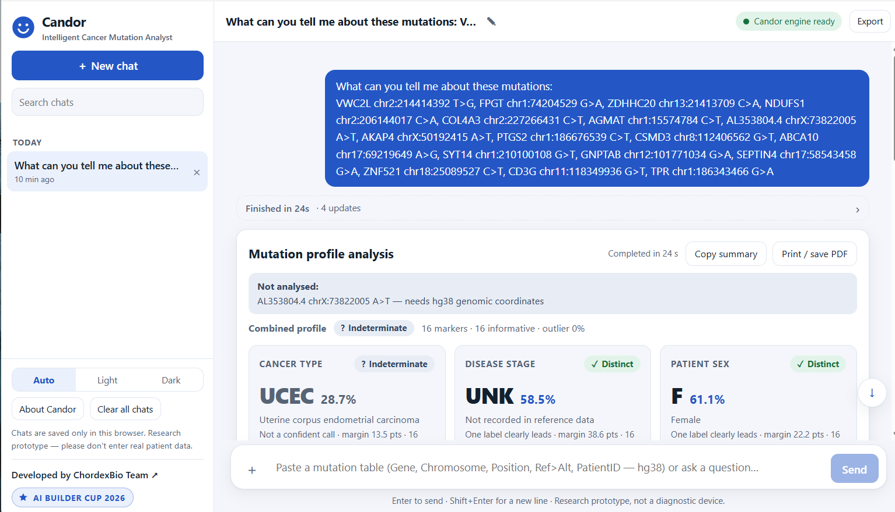
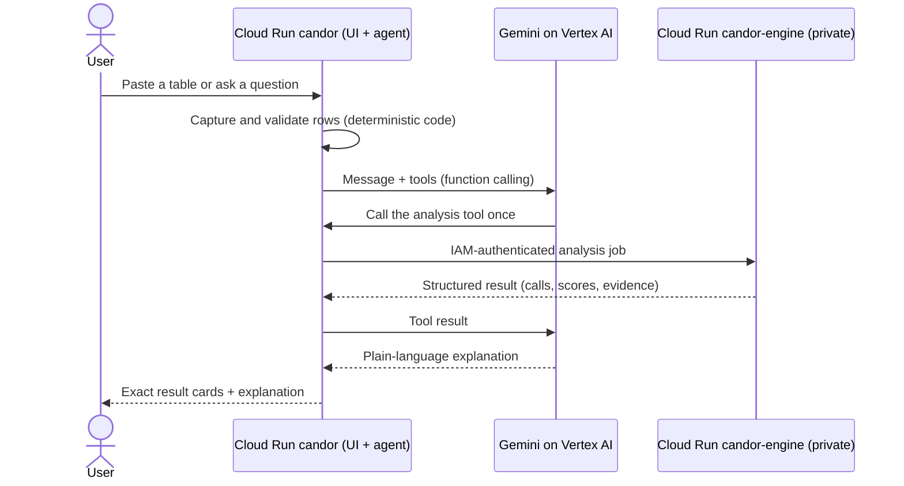
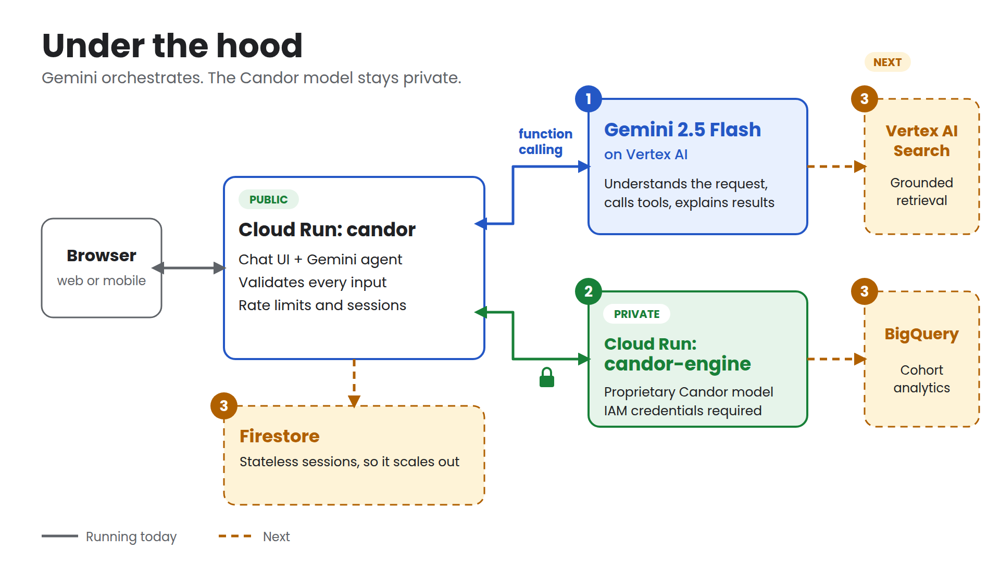

# Candor: Intelligent Cancer Mutation Analyst

**AI Builder Cup 2026 · Category: Future of Work & Enterprise Productivity · Team ChordexBio**

> Paste a tumor's mutation table. Ask in plain language. Get an evidence-backed, honestly labelled profile and a
> plain-language explanation, all in one conversation.



| For judges | Where |
|---|---|
| Hosted demo and access code | Provided in the AI Builder Cup submission form (not published in this repository) |
| 3 to 4 minute demo video | Linked in the submission form |
| Architecture in one picture | [docs/images/architecture.png](docs/images/architecture.png) |
| Run it yourself, no private access needed | [Option B: synthetic test engine](#9-run-it) |
| Judging criteria, mapped to files | [Section 13](#13-judging-criteria-map) |

---

## 1. Brief about the idea

**The gap.** Clinicians, researchers and institutions face a growing burden of accessing, interpreting and
synthesizing complex cancer mutational and clinical knowledge. Because cancer is heterogeneous and multifactorial,
profiling and interpreting mutations needs scarce specialist time and compute. Conventionally this work commonly takes
**2 to 3 weeks** ([Das et al., Scientific Reports 2025](https://doi.org/10.1038/s41598-025-08039-6);
[AJMC](https://www.ajmc.com/view/molecular-testing-turnaround-times-and-treatment-decisions)), and delays persist across
institutions with limited resources
([JCO Oncology Practice, via Targeted Oncology, Aug 2026](https://www.targetedonc.com/view/study-finds-genomic-profiling-turnaround-time-improves-but-delays-persist)).

**The idea.** A future of work where AI and clinicians work together to boost clinical productivity: democratizing
access to clinical knowledge and speeding up the analysis and synthesis of large mutational profiles, so that
informed decisions and more effective diagnosis and treatment strategies can reach millions of cancer patients globally.

**The solution: agentic AI.** Candor is an intelligent cancer mutation analyst built using **Gemini**. Its specialist
model was trained on 2.5M+ mutations from 11,160 TCGA patients across 33 cancer types. It predicts cancer type, stage
and sex with confidence scores, evidence and closest reference profiles, and explains the results without leaving the chat.

*Candor supports the analysis and interpretation stage. It does not replace sequencing or clinical judgement.*

## 2. Opportunities: why Candor is different

| Differentiation | Problem solving | Unique value |
|---|---|---|
| **Specialist model + agentic LLM:** the model profiles, Gemini orchestrates and explains | **Deployable as an agent:** a researcher or an institution only needs a browser | **Designed to take data-analytic work from weeks to minutes**; time-to-result is shown on every analysis |
| **Grounded predictions:** numbers come from the model trained on real clinical cohort data (TCGA), not from generated text | **LLM-based:** lowers the barrier to technical expertise; no computational or data-analytic skills needed | **Evidence-based insights:** markers, closest reference profiles, validation notes |
| **Declines to guess:** shared, indeterminate and outlier calls are shown, never hidden | **Expandable and trainable:** roadmap includes shared workspaces and new data sources | **Answers in the chat,** without hopping between tools and websites |
| **Data is never retyped:** tables reach the engine exactly as pasted | | **Suggests interpretation and states limitations** of the analysis |

## 3. The four cornerstones

| Cornerstone | How Candor delivers it |
|---|---|
| **Time** | Profiling while you wait, with the elapsed time shown on every result; a trained model predicts rather than returning search hits |
| **Access** | Plain-language chat, standard mutation tables (`.csv`, `.tsv`, `.txt`), no pipeline and no local compute |
| **Collaboration** | Copy summary, print or save PDF, export the conversation, saved chats; works on web and mobile |
| **Trust** | Evidence on demand, built-in input validation, and honest labelling of weak evidence |

## 4. Features

1. **Ask in plain language.** Gemini understands the question and decides when to call the Candor engine.
2. **Paste or upload mutations.** Standard tables, captured exactly by the app.
3. **Profiling in minutes.** Against the 2.5M+ mutation reference; elapsed time is displayed. See [section 10](#10-tests-and-prototype-performance).
4. **Evidence on demand.** Top markers, closest reference profiles and validation notes.
5. **Built-in validation.** hg38 checks, format checks and limits; unsafe input is queried, never guessed.
6. **Honest answers.** Exact model output; weak or ambiguous evidence is flagged, never invented.
7. **Predictive, not just searched.** A trained model scores cancer type, stage and sex.
8. **Works on any device.** Web and mobile, with copy summary and print / save PDF.

## 5. Process flow



When input is weak or unsafe: protein-level input (for example `KRAS G12D`) triggers a request for hg38 coordinates;
weak evidence is shown as *shared*, *indeterminate* or *outlier*; several PatientIDs in one table are pooled and the
pooling is disclosed.

## 6. Wireframe and snapshots

The interface is one workspace: saved chats and search in a sidebar, a chat area with live progress, result cards
(cancer type, stage, sex, each with an honest badge), Copy summary / Print / Export, and a composer that accepts pasted
or uploaded tables. It supports light and dark themes and a phone-width layout. See the screenshot above and
[app/static/index.html](app/static/index.html).

## 7. Architecture



| Public (this repository) | Private (not in this repository) |
|---|---|
| Web app, chat UI, Gemini agent and tool definitions | The Candor analysis model and weights |
| Deterministic input parsing and validation | Training and reference data |
| Sessions, rate limits, access code, security headers | The engine service that serves the model |
| A synthetic test engine, tests, deploy script | |

Details: [docs/ARCHITECTURE.md](docs/ARCHITECTURE.md).

## 8. Technologies

| Layer | Technology |
|---|---|
| Generative AI | **Gemini 2.5 Flash on Vertex AI** (Google Gen AI SDK, global endpoint), function calling, system-prompt grounding (not fine-tuned) |
| Compute and deployment | **Cloud Run** (two services), Cloud Build, Artifact Registry |
| Security | Cloud Run IAM for service-to-service calls, **Secret Manager**, least-privilege service accounts, CSP, rate limits, generic errors |
| Application | Python 3.11, FastAPI, Uvicorn, httpx; dependency-free HTML/CSS/JS front end (no CDN) |
| Planned | Firestore, BigQuery, Vertex AI Search, ADK / Agent Engine, Document AI |

## 9. Run it

### Option A: hosted demo
Use the link and access code from the submission form.

### Option B: locally, with the synthetic test engine
This runs the real web app and the real Gemini agent against a **synthetic** engine, so no private access is needed.
You need a Google Cloud project with the Vertex AI API enabled.

```bash
git clone https://github.com/mahvin92/Candor.git && cd Candor
python -m venv .venv && source .venv/bin/activate
pip install -r app/requirements.txt -r mock_engine/requirements.txt

gcloud auth application-default login            # Gemini on Vertex AI needs credentials
export GOOGLE_CLOUD_PROJECT=<your-project-id>
export CANDOR_ENGINE_MODE=mock CANDOR_ENGINE_KEY=local-dev-key CANDOR_ENGINE_URL=http://localhost:9000

uvicorn mock_engine.main:app --port 9000 &       # synthetic test engine
cd app && uvicorn main:app --port 8080           # open http://localhost:8080
```

> **The test engine is not Candor.** Its output is pseudo-random, uses placeholder labels (`SYN-A`, `SYN-1`, ...), carries a
> notice in every profile, and in this mode Gemini is instructed to begin every answer with "Synthetic test output,
> not a real Candor result." Never present it as a result.

### Option C: deploy to Cloud Run with your own engine
```bash
export PROJECT_ID=<your-project-id> CHECKPOINT_PATH=<model-bundle-identifier>
bash scripts/deploy_cloud_run.sh
```
The script needs a private engine reachable as a Cloud Run service (`candor-engine`) or via `CANDOR_ENGINE_URL`, and a
Secret Manager secret `CANDOR_ENGINE_KEY`. It builds the image, creates a least-privilege service account, stores the
access code in Secret Manager and prints the URL.

## 10. Tests and prototype performance

```bash
pip install -r requirements-dev.txt && pytest -q      # 18 tests, no Gemini or private engine needed
```

* **14 guardrail tests** (`tests/test_guardrails.py`): pasted tables are captured exactly; typed hotspots become
  validated hg38 records; protein-level input is never converted to coordinates; malformed input (ref = alt, invalid
  chromosome, RefSeq accessions) is rejected; coordinate notations are normalised; variant and row caps hold; errors
  scrub the engine URL and secrets.
* **4 integration tests** (`tests/test_mock_engine.py`) run the app's engine client against the synthetic engine over HTTP.

| Operating limit (defaults) | Value |
|---|---|
| Rows per pasted table | 500 |
| Typed variants per request | 200 |
| Turns per session | 30 |
| Requests per client IP per hour | 60 |
| Parallel analyses | 2 |

**Observed example:** on the hosted demo, a 16-marker table completed in 24 seconds (single run; not a benchmark).
**Not claimed yet:** Candor's own held-out accuracy, sensitivity and time saved are not reported here. Next steps are
held-out TCGA validation and a timed comparison with a manual workflow.

## 11. Estimated cost

An always-on demo configuration (web 1 vCPU / 1 GiB, engine 4 vCPU / 16 GiB) is about **US$386 per month** at list
price, plus roughly **US$0.007 per Gemini analysis turn**. Assumptions and levers: [docs/COST.md](docs/COST.md).

## 12. Roadmap

| Now (prototype) | Next (3 to 6 months) | Scale (6 to 12+ months) |
|---|---|---|
| Gemini agent + private engine on Cloud Run | Held-out and external cohort validation; publish accuracy and calibration | ADK multi-agent workflow on Agent Engine |
| Cancer type, stage and sex calls from TCGA reference matching | Firestore-backed sessions: stateless and autoscaling | BigQuery for cohort analytics and institutional knowledge |
| Honest classifications and deterministic guardrails | Vertex AI Search grounding with citations | Document AI for pathology and lab reports |
| Access code, rate limits, health checks | VCF / MAF upload and validated variant normalisation | Shared workspaces and tumor-board summaries |

## 13. Judging criteria map

| Criterion (weight) | Where to look |
|---|---|
| **Technical Merit and Gen AI (40%)** | Gemini with function calling: [app/main.py](app/main.py), [app/candor_tools.py](app/candor_tools.py), [app/system_prompt.py](app/system_prompt.py). Implementation: [app/demo_core.py](app/demo_core.py) (sessions, rate limits, background jobs), [tests/](tests/), [scripts/deploy_cloud_run.sh](scripts/deploy_cloud_run.sh). Scalability: [docs/ARCHITECTURE.md](docs/ARCHITECTURE.md), [docs/COST.md](docs/COST.md), roadmap above |
| **Problem Alignment and Impact (25%)** | Sections 1 to 3: knowledge access, decision-making and workflow execution for mutation analysis |
| **Innovation and Creativity (25%)** | Specialist model plus agentic LLM; the deterministic data path and honest abstention ([app/candor_tools.py](app/candor_tools.py), [tests/test_guardrails.py](tests/test_guardrails.py)) |
| **UX and Solution Design (10%)** | [app/static/index.html](app/static/index.html): guided examples, drag and drop, keyboard focus, ARIA live regions, light / dark, mobile and print layouts |

## 14. Responsible use

Candor is a **research prototype, not a diagnostic device.** Calls come from matching against public reference cohort
data and must be reviewed by a qualified clinician or pathologist. Do not enter real patient data. See
[docs/RESPONSIBLE_USE.md](docs/RESPONSIBLE_USE.md).

## 15. What is not in this repository

The Candor model, its weights, its training and reference data, and the engine service are proprietary to ChordexBio.
The web app talks to the engine through a small authenticated HTTP API (see `_run_predict` in
[app/candor_tools.py](app/candor_tools.py)); the synthetic engine in [mock_engine/](mock_engine/) implements the same contract.

## Associated terms

Data derived from [TCGA](https://www.cancer.gov/ccg/research/genome-sequencing/tcga) is subject to its own terms of use.
